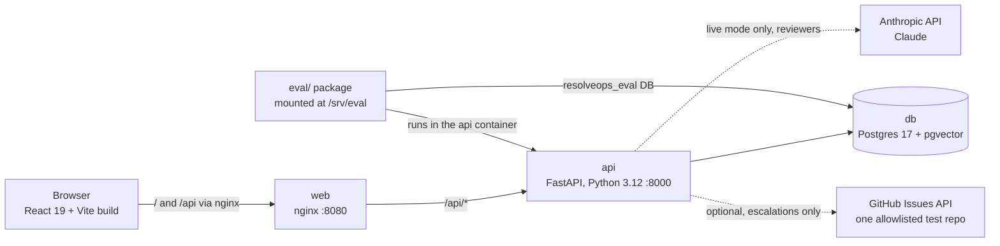
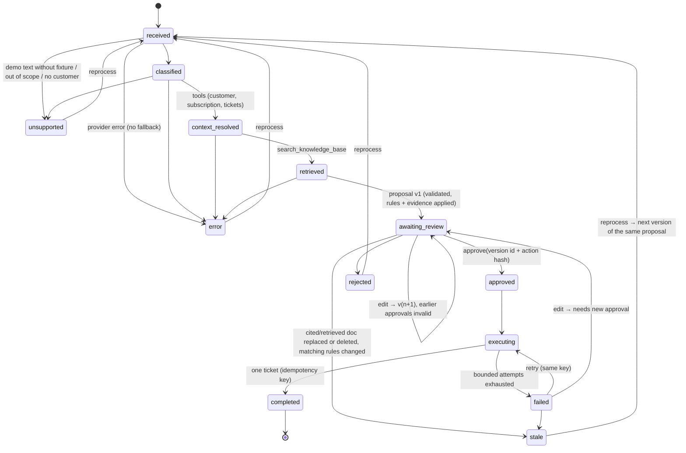
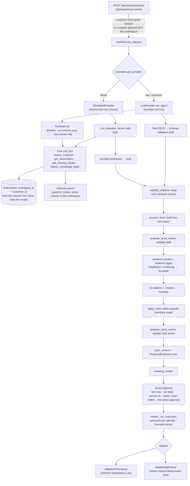
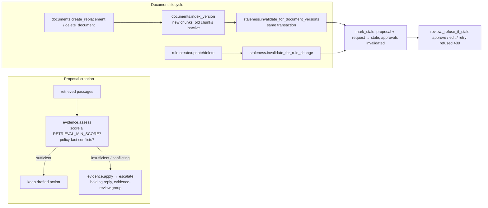

# Architecture

ResolveOps is three containers plus an evaluation package. The rule the whole design follows: **the AI
proposes, ordinary code decides.** Identity, permissions, escalation rules, evidence sufficiency, citation
validity, approval and execution are all enforced in Python, never by the model.

## 1. Containers

- `docker-compose.yml`: `db` (pgvector image, named volume `pgdata`), `api` (built from `backend/`, runs
  migrations then seeds on first start via `start.sh`), `web` (built from `frontend/`, nginx serving the build and
  proxying `/api`).
- The embedding model (`BAAI/bge-small-en-v1.5`, 384-dim, `fastembed`) is baked into the api image, so
  retrieval needs no network.
- Test and eval suites use their own databases (`resolveops_test`, `resolveops_eval`) on the same server. They
  never touch the demo data.

## 2. Request workflow (explicit state machine, `backend/app/workflow.py`)

`TRANSITIONS` in `workflow.py` is the single table of legal moves. `transition()` refuses anything else and
audits every move.

## 3. One request through the code

## 4. Tool gate and provider interface

- **Provider interface** (`providers/base.py`): `AIProvider.classify`, `synthesize`, and for agentic providers
  `run_agent`. Providers interpret language and draft. They never authorize, validate, approve or execute.
  `ProviderError` is surfaced as the `error` state. There is no simulated fallback.
  - `SimulatedProvider` (`providers/simulated.py`): exact-match fixtures per workspace, rendered from tool results
    and retrieved passages; cites a section only if retrieval returned it. Unknown text raises `UnsupportedInDemo`.
  - `LiveProvider` (`providers/live.py`): Claude via the official SDK, tool use, structured final output, bounded
    retries, per-request token cap. Prompt construction is in `providers/live_prompt.py`.
- **Tool gate** (`providers/live_guard.py:ToolGate.run`): every model-requested tool call passes through it. It
  refuses tools not on the allowlist, refuses arguments that try to set identity
  (`customer_id`, `workspace_id`, …), and refuses ticket ids that are not the authorized customer's. Each refusal
  is audited.
- **Tools** (`tools.py`): typed Pydantic arguments, `ToolContext` carries the trusted scope, and every query
  filters by `workspace_id` and the authorized `customer_id` (`_require_customer`). `lookup_customer` reports
  mentioned foreign emails as "not accessed" and never looks them up. `propose_ticket_action` validates and
  never writes.

## 5. Evidence and staleness checks

- Every proposal version records the exact document versions and chunks it retrieved and cited
  (`ProposalEvidence`). Replacing or deleting a document marks every pending proposal that used it as stale in
  the same database transaction.
- Citations always open the exact version they cite (`GET /api/w/{ws}/chunks/{id}`), labelled superseded or
  deleted when it is no longer current.

## 6. Scoping (who sees what)

- `context.py:actor_for_workspace` resolves each request to an `Actor`: a **reviewer** (member of this
  workspace) or a **visitor** (demo session in a demo-enabled workspace). Anything else gets 401.
- `context.py:scope_clause` limits session-scoped tables (requests, executions, tickets, AI runs, audit) to the
  caller's demo session, or to the workspace queue for reviewers. The inbox, request detail, tickets and the
  dashboard all use it.
- Visitors never use live mode (`providers.live_for`), never reach admin routes (`require_reviewer`), and never
  use GitHub (`review._adapter_name`).

## 7. Evaluation (`eval/`)

- `run_ai_eval.py`: drives each case in `datasets/v1/cases.jsonl` through the real HTTP API (in-process
  TestClient) against `resolveops_eval`, then computes metrics (`metrics.py`). Demo results are labelled
  simulated. Live needs a key. `baseline.py` is the prompt-only comparison (live only).
- `run_backend_eval.py`: runs 64 selected backend tests, grouped into SPEC §13 categories.
- Results go to `eval/results/<suite>-<mode>-<date>.json`. The dashboard reads the latest per suite and mode.
  Write-up: `eval/RESULTS.md`.

Design decisions and tradeoffs: [`DECISIONS.md`](DECISIONS.md) (D1–D33).
